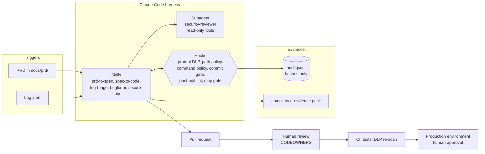
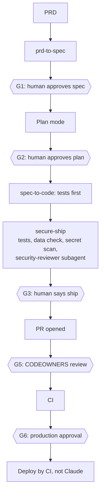
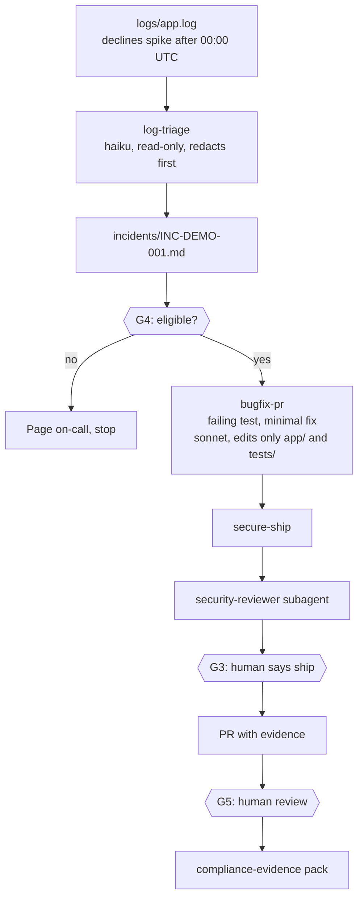
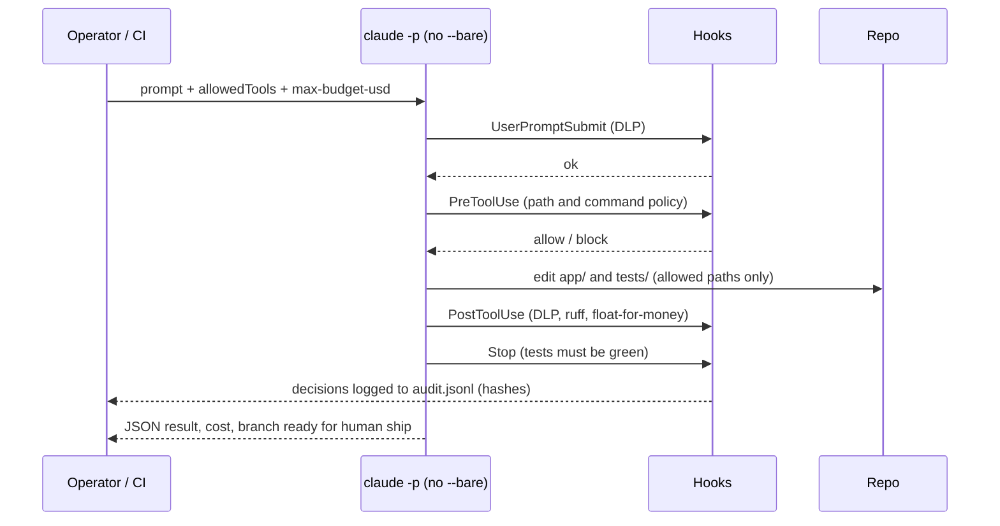
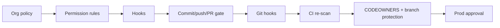
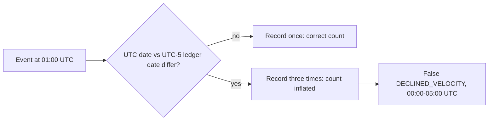

# Demo diagrams (Mermaid)

GitHub renders these inline. For slides, open this file on GitHub and screenshot each diagram, or paste the source into any Mermaid renderer.

## Harness overview

## Flow 1: PRD to prod

## Flow 2: log alert to fix PR

## Sequence: one headless run with hooks live

## Defence in depth (guardrail layers)

## What the bug looks like

